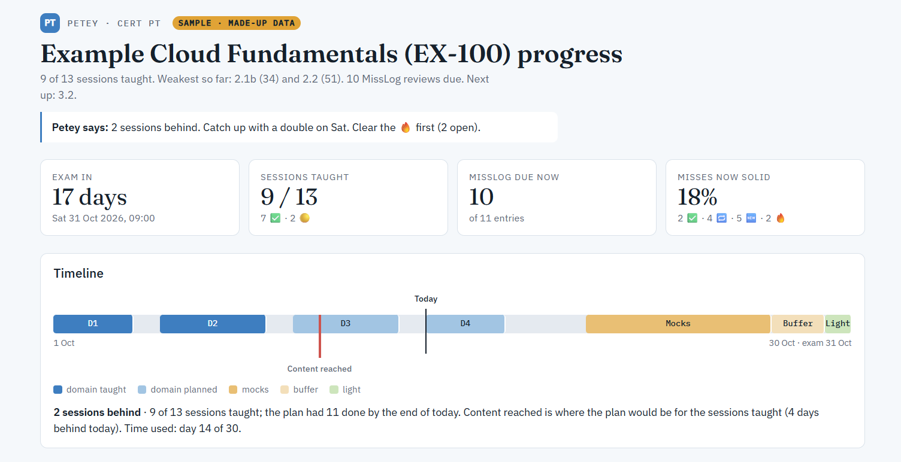
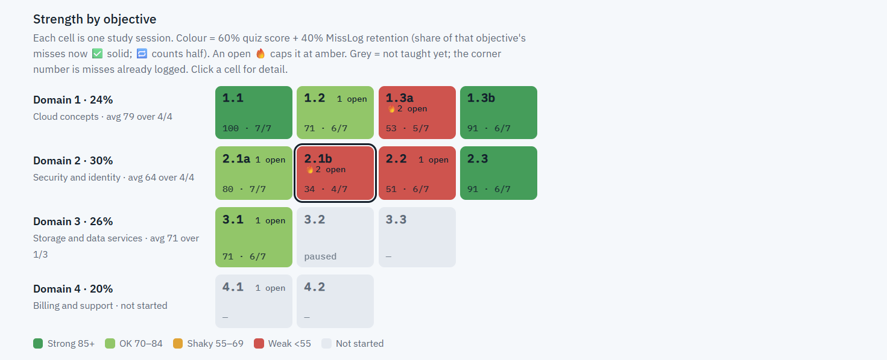
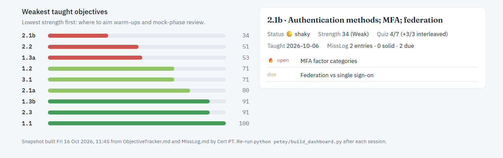

```
   .-------.
   | o   o |      PETEY
   |   ^   |      the Cert PT
   | \___/ |
   '---+---'      Teach. Test. Repair. Repeat.
  o====|====o
      / \
```

# Cert PT: Petey, a personal trainer for certification exams

Cert PT is a study method that runs inside [Claude Code](https://claude.com/claude-code). Petey teaches each exam objective in short chunks, then quizzes you in the style of the official sample questions and asks how sure you are. Every miss goes into a log that brings it back for review at 1, 3, 7 and 14 days. Claims are checked against the vendor's official docs, with links. A dashboard shows which objectives are strong and whether you're on pace for exam day. The difference from "ask a chatbot to quiz me" is the method, not the AI. It works for any exam with a published study guide and an official docs site: Snowflake, Microsoft Fabric/Azure, Databricks, AWS, GCP and others.

> v0.2. Used for SnowPro Core (COF-C03): passed first attempt, 805/1000 (pass mark 750). The method changes since v0.1 come from that run; see [docs/method.md](docs/method.md).

## The method in five points

1. **Teach before testing.** Short chunks with a check question after each. Never a cold quiz on material you haven't seen.
2. **Confidence ratings on every answer** (1 = guess or toss-up, 2 = leaning, 3 = sure). A confident wrong answer is flagged 🔥 and gets extra repair: those are the misconceptions that cost marks on exam day.
3. **A miss log with spaced review.** Every miss is re-tested at **1 → 3 → 7 → 14 days**, and a wrong review resets it. Each day's warm-up pulls the due ones.
4. **Fact-checked against the official docs**, with citations. Petey keeps a renamed-products table, so old names don't slip in, and flags practice-bank answers that disagree with the docs.
5. **Progress you can see.** A dashboard with a strength heatmap per objective and a plan-vs-progress timeline.

The full reasoning, including what went wrong before each rule was added: [docs/method.md](docs/method.md).

## Who it suits

- People who **don't learn well from long video courses** and would rather be taught interactively and tested straight away.
- People who've found **practice banks unlike the real exam** and want to learn the objectives rather than memorise answer keys.
- **Experienced practitioners moving to a new platform.** Tell Petey what you know best (say, Microsoft Fabric) and new concepts get explained as differences from it.

It probably doesn't suit you if you prefer a structured video course, or if you want a question bank to drill. Petey isn't one, and it doesn't ship any exam questions.

## What a session looks like

An excerpt from a session for a fictional exam:

```
Petey:  Q4 (multi-select). A team must keep serving traffic if one data centre
        fails, at the lowest extra cost. Which TWO changes meet this?
        A) Deploy to a second region   B) Spread instances across two zones
        C) Add a load balancer across zones   D) Use a bigger instance
        Answer with letters and a confidence of 1-3.
You:    A, C, conf 3
Petey:  Not quite. B + C. A also survives a data-centre failure, but a second
        region is the expensive option, and the question asked for the lowest
        cost. Confident and wrong, so it's marked 🔥 and goes in the miss log
        for review tomorrow. Questions before we go on?
```

A session runs warm-up → orient → teach → fact card → explain it back → 10-question quiz → repair → close-out, in about 60-80 minutes. Say "pause" at any point and Petey writes a resume note. Once every objective is taught, sessions switch to **retrieval mode**: warm-up → timed questions → fast repair.

## Setup

You need [Claude Code](https://claude.com/claude-code), git and Python 3.8+ (for the dashboard; standard library only).

1. **Create your own copy.** Click **Use this template → Create a new repository** and make it **private**. (A fork of a public repo is public. Your miss log will hold paraphrased practice questions and notes you won't want public. The generated files are gitignored either way.)
2. **Clone it** and open a terminal in the folder.
3. **Add your study guide.** Download the official exam guide or skills outline PDF from the vendor and save it in `guide/`. It stays out of git.
4. **Run the setup.** In a terminal in the repo folder (not `guide/`), run `claude` to open Claude Code. Then type `/init-exam` at Claude Code's prompt, not in PowerShell or bash, where it isn't a command. Petey reads the guide, shows you the objectives split into sessions, and asks a few things it can't work out: exam date, start date, the platform you know best, which days you can study, and which practice exams you have. It then writes your files:

   | File | What it's for |
   |---|---|
   | `CLAUDE.md` | Exam setup: trusted docs, analogy platform, renamed products. Imports the generic rules in `petey/method.md` |
   | `ObjectiveTracker.md` | Daily schedule, status per session, resume note, "are we on track?" checks |
   | `MissLog.md` | Every miss with its reasoning, memory hook and review log |
   | `QuickRef.md` | One "rules + exceptions" block per objective, for rereading |
   | `StudyPlan.md` | Phases, readiness gate, hot topics from pass reports, exam-day tactics |
   | `LessonsLearned.md` | What's working and what isn't |
   | `exam.json` | Dates and phases for the dashboard |

5. **Study.** Say **"next objective"** to start a session. Petey checks your pace against the schedule each time.

## The dashboard

```
python petey/build_dashboard.py
```

This writes `Dashboard.html`, a snapshot you open in a browser. It has a strength heatmap (domain × objective), a timeline of plan vs progress, a pace verdict, your weakest objectives, and a one-line "Petey says" (e.g. *2 sessions behind. Catch up with a double on Sat.*). Light and dark themes. Re-run it after each session.

*Sample dashboard for a fictional exam with made-up data. Build it yourself with `python petey/build_dashboard.py --dir examples/sample`.*







### The game view

```
python petey/build_game.py
```

This writes `GameDashboard.html`, a gamified view of the same data, for days when motivation is the problem rather than knowledge. It has a study streak, XP for reviews, sessions and mocks (showing up earns some, getting it right earns more), today's quests, a GitHub-style activity grid, mock exams as "boss fights", and badges. Its **exam-readiness bar** only fills to 100% when every objective is taught, weighted strength is ≥ 75, no objective is red, the latest mock is ≥ 80% on taught objectives, and no 🔥 items are open. That's a judgment rule, not a prediction. Mock results come from the "Mock exams" table in `ObjectiveTracker.md`. Try it with `python petey/build_game.py --dir examples/sample`.

## What it costs

- **The kit:** free (MIT).
- **Claude Code:** a paid Claude plan (Pro or above) or API usage; see [current pricing](https://claude.com/pricing). Sessions are long, interactive conversations, so on lower plans you may hit usage limits on heavy days.
- **Practice exams:** optional, but recommended for the mock phase. The vendor's official practice test, where one exists, is the most useful readiness signal. Third-party banks vary in quality.

## What's in the repo, and what stays private

```
.claude/skills/init-exam/   /init-exam setup skill
petey/method.md             generic tutor rules (session loop, spaced review, statuses)
petey/build_dashboard.py    dashboard builder (standard library only)
petey/build_game.py         gamified dashboard builder (standard library only)
templates/                  skeletons /init-exam fills in
examples/sample/            fictional exam with made-up data (labelled SAMPLE)
docs/                       method write-up, text logo
guide/                      your study guide PDF goes here (ignored by git)
```

No study guides, exam questions, practice-bank content or personal progress ship in this repo. Your generated files and PDFs are in `.gitignore`. Certification agreements usually forbid sharing real exam content, so don't paste it into issues or pull requests.

Method updates arrive via `git pull` (into `petey/method.md`) and don't touch your files. Put exam-specific tweaks in your `CLAUDE.md`.

## Limitations

- **Petey can be wrong.** It cites the docs so you can check it. Treat claims without a link as unverified.
- **No one has real exam statistics.** Petey won't claim a topic is "heavily tested" without saying why.
- **It's a method, not a guarantee.** So far one person (me) has used it, on one exam, and passed. Your results will vary.
- **The guide isn't the whole exam.** My biggest surprise on the day was a feature the study guide never names, though pass reports had flagged it. Petey now cards every hot topic you add to `StudyPlan.md`, but it can only cover the ones you find.
- v0.2 assumes one exam per copy of the repo.

## Licence and contributing

MIT; see [LICENSE](LICENSE). Issues and pull requests are welcome, especially reports from using it on a different vendor's exam. Keep exam content out of them.
